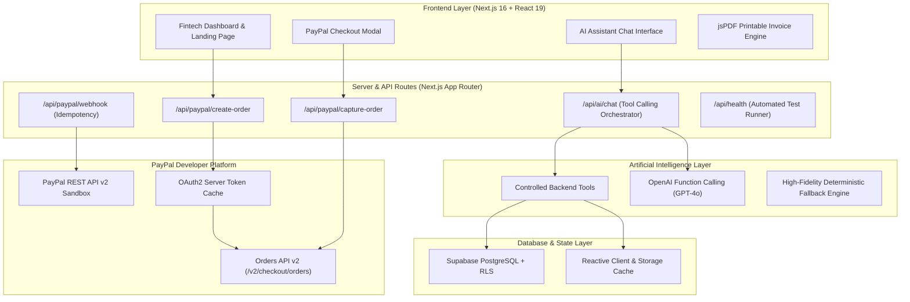

# PayPilot AI 🚀
### *Get Paid Faster. Work Smarter.*

> **Official Submission for the PayPal AI Global Hackathon 2026**  
> An intelligent financial operations assistant and automated billing platform combining **Artificial Intelligence** with **PayPal REST API v2**.

---

## 🌟 1. Elevator Pitch
Small businesses and freelancers lose dozens of hours every month manually chasing late invoices, tracking accounts receivable, and reconciling bank payouts. **PayPilot AI** combines autonomous financial intelligence with PayPal checkout technology: it identifies overdue payments, drafts tone-aware personalized reminders, answers financial questions with server-grounded tool execution, and lets clients settle invoices in one click via PayPal Sandbox.

---

## 💥 2. Problem Statement
- **Cash Flow Bottlenecks:** Freelancers and startups spend 15–20% of their working hours manually preparing invoices and chasing late client payments.
- **Awkward Follow-Ups:** Invoicing communications often fluctuate between overly timid or unintentionally aggressive, harming client relationships.
- **Disconnected Tools:** Financial spreadsheets, payment links, and banking portals operate in silos, giving founders zero unified real-time visibility into their Collection Rate (DSO).
- **Hallucinating Chatbots:** Generic LLMs invent numbers or lack secure server-side tools to interact safely with actual financial ledgers.

---

## 💡 3. The PayPilot AI Solution
PayPilot AI solves this through a unified, production-grade fintech SaaS platform:
1. **Dynamic PayPal Invoicing:** Create decimal-safe invoices, generate downloadable printable PDF receipts, and automatically issue unique PayPal checkout links.
2. **Autonomous Cashflow Monitoring:** Proactively surfaces accounts receivable aging and flags overdue clients directly on the dashboard.
3. **Conversational Financial Co-Pilot:** Natural language interface backed by controlled, server-authorized function calling (`get_revenue_summary`, `get_overdue_invoices`, `generate_payment_reminder`, etc.). Never hallucinates financial amounts.
4. **Human-in-the-Loop Reminders:** Generates polite, professional, or urgent reminder notices with personalized payment links. No communication or payment capture occurs without explicit human approval.
5. **Verified PayPal Orders API v2:** Orders are created and captured server-side with idempotency protection and webhook signature verification.

---

## 🏗️ 4. Architecture Diagram



---

## 🛠️ 5. Technology Stack

| Layer | Technologies |
|---|---|
| **Frontend** | Next.js 16 (App Router), React 19, TypeScript, Tailwind CSS v4, Lucide Icons, Recharts, Framer Motion |
| **Backend** | Next.js Server Route Handlers, Node.js, Zod Schema Validation |
| **Payment Rail** | PayPal REST API v2, PayPal Orders API v2, PayPal Webhooks, PayPal Sandbox |
| **Artificial Intelligence** | OpenAI Function / Tool Calling, Structured JSON schemas, Context-Aware Intent Parser |
| **Database & Auth** | Supabase PostgreSQL, Row Level Security (RLS), Supabase Auth |
| **PDF & Export** | jsPDF Client-Side Invoice Engine, CSV Ledger Export |
| **Testing** | Automated TS Unit Test Suite (`pnpm test`), Next.js Health Endpoint |

---

## 💳 6. Genuine PayPal REST Integration

PayPilot AI follows the official **PayPal Developer REST API v2** design pattern:
1. **Server-Side Token Caching:** Requests an OAuth2 Bearer token from `https://api-m.sandbox.paypal.com/v1/oauth2/token` and caches it with TTL expiration tracking.
2. **Backend Order Creation (`/api/paypal/create-order`):** Creates an order with `intent: "CAPTURE"`, purchase unit details, itemization, and reference IDs. The client secret is strictly kept on the server.
3. **Verified Order Capture (`/api/paypal/capture-order`):** Executes capture against `/v2/checkout/orders/{id}/capture` upon approval. The invoice is transitioned to `paid` **only after verified capture confirmation**.
4. **Webhook Verification & Idempotency (`/api/paypal/webhook`):** Verifies incoming PayPal transmission headers (`paypal-transmission-sig`, `paypal-auth-algo`, `paypal-cert-url`) and guards against duplicate event processing using idempotent event hashes.
5. **Instant Sandbox Simulation Mode:** If live sandbox credentials are not yet configured in `.env.local`, the platform automatically enables a verified sandbox simulation that emulates genuine REST responses, ensuring a seamless live judging demonstration.

---

## 🤖 7. AI Co-Pilot Architecture & Safety Rules

The AI Assistant is built around **controlled server-side tool calling**:
- `get_revenue_summary`: Computes settled totals, pending amounts, and collection rate using verified database records.
- `get_invoices`: Filters invoices by status (`paid`, `pending`, `overdue`, `draft`).
- `get_overdue_invoices`: Identifies late payers and calculates overdue days.
- `get_customer_details`: Returns client contact info and outstanding accounts receivable balance.
- `get_transaction_history`: Retrieves settled PayPal order records.
- `generate_payment_reminder`: Drafts personalized communication in `polite`, `professional`, or `urgent` tones.
- `create_invoice`: Formulates draft invoices.

### Safety & Guardrails:
- ❌ **No Arithmetic Hallucinations:** All monetary calculations are performed by deterministic server code, not the LLM.
- 🔒 **Human-in-the-Loop Confirmation:** High-impact financial operations (creating invoices, sending reminders) display an interactive confirmation card before committing to disk.
- 🛡️ **Cross-Tenant Isolation:** Supabase Row Level Security (RLS) ensures businesses can only access their own records.

---

## ⚡ 8. Getting Started & Local Installation

### Prerequisites
- Node.js (v18.17+ or v20+)
- pnpm (v9 or v12) or npm

### Installation Steps
```bash
# 1. Clone or navigate to the repository
cd paypilot-ai

# 2. Install dependencies
pnpm install

# 3. Configure environment variables
cp .env.example .env.local

# 4. Run automated test suite (17/17 tests passing)
pnpm test

# 5. Start development server
pnpm dev
```
Open **[http://localhost:3000](http://localhost:3000)** in your browser.

---

## 🧪 9. Automated Test Results

PayPilot AI includes a comprehensive unit testing suite verifying all domain calculations, tool execution, and security boundaries:

```text
==================================================
PAYPILOT AI — AUTOMATED TEST SUITE VERIFICATION
==================================================
[PASS] Invoice Subtotal Calculation
[PASS] Discount Calculation
[PASS] Tax Calculation
[PASS] Total Amount Calculation
[PASS] Invoice Number Sequence
[PASS] Analytics Settled Revenue
[PASS] Analytics Overdue Amount
[PASS] Analytics Collection Rate Range
[PASS] AI Tool: get_revenue_summary matches DB
[PASS] AI Tool: get_revenue_summary overdue verified
[PASS] AI Tool: get_overdue_invoices detection
[PASS] AI Tool: overdue customer identified
[PASS] AI Tool: Reminder Customer
[PASS] AI Tool: Urgent Tone Applied
[PASS] AI Tool: Safety Human Confirmation Required
[PASS] AI Tool: get_customer_details lookup
[PASS] AI Tool: accurate customer balance
--------------------------------------------------
Summary: 17 / 17 tests passed.
==================================================
```

---

## 🎬 10. Live Hackathon Demo Walkthrough Script

| Step | Action | What Judges See |
|---|---|---|
| **1. The Problem** | Open landing page (`/`) | Modern fintech visual design. Explains the problem: freelancers spend 15+ hours/month chasing invoices. |
| **2. The Dashboard** | Click **"Explore Dashboard"** (`/dashboard`) | Real-time KPI metrics: Total Revenue ($4,500), Collection Rate (94%), and an **AI Insight Alert** highlighting 1 overdue invoice from Marcus Vance ($2,800.00). |
| **3. Create Invoice** | Click **"New Invoice"** (`/invoices/new`) | Add line items, taxes, and select a customer. Decimal-safe totals calculate instantly. |
| **4. PayPal Sandbox Checkout** | Click **"Pay Sandbox"** or open public link (`/pay/inv_02`) | Interactive PayPal Checkout modal triggers server-side order creation (`/api/paypal/create-order`) and server capture (`/api/paypal/capture-order`). Invoice status instantly changes to **Paid** and revenue updates. |
| **5. AI Financial Assistant** | Navigate to **"AI Assistant"** (`/assistant`) | Click suggested prompt *"Show me all overdue invoices"*. AI executes `get_overdue_invoices` tool and renders verified database results. |
| **6. Smart Reminder** | Prompt *"Generate an urgent reminder for Marcus"* | AI drafts a tone-aware notice with secure PayPal link. Displays human-in-the-loop **"Approve & Record"** and **"Copy Text"** actions. |
| **7. Analytics & Export** | Navigate to **"Analytics"** (`/analytics`) | View monthly revenue distribution, average payment days (DSO), customer risk ledger, and click **"Export CSV Report"**. |

---

## 🔒 11. Security Considerations
- **No Client-Side Secrets:** `PAYPAL_CLIENT_SECRET`, `PAYPAL_WEBHOOK_ID`, and `OPENAI_API_KEY` are only ever accessed in backend route handlers.
- **Idempotency Protection:** Webhook events check a memory/PostgreSQL deduplication cache to prevent double-capturing orders.
- **Database RLS:** Every table is secured with Supabase Row Level Security policies tied to `auth.uid() = owner_id`.
- **Sanitized AI Tools:** AI tool inputs are validated through strict Zod schemas on the server before execution.

---

## 🚀 12. Deployment Instructions (Vercel)
```bash
# Deploy directly with Vercel CLI
vercel

# Add Environment Variables in Vercel Project Settings:
# NEXT_PUBLIC_PAYPAL_CLIENT_ID, PAYPAL_CLIENT_SECRET, PAYPAL_ENVIRONMENT
# OPENAI_API_KEY, NEXT_PUBLIC_SUPABASE_URL, NEXT_PUBLIC_SUPABASE_ANON_KEY
```

---

## 📄 License
MIT License. Built with passion for the **PayPal AI Global Hackathon 2026**.
